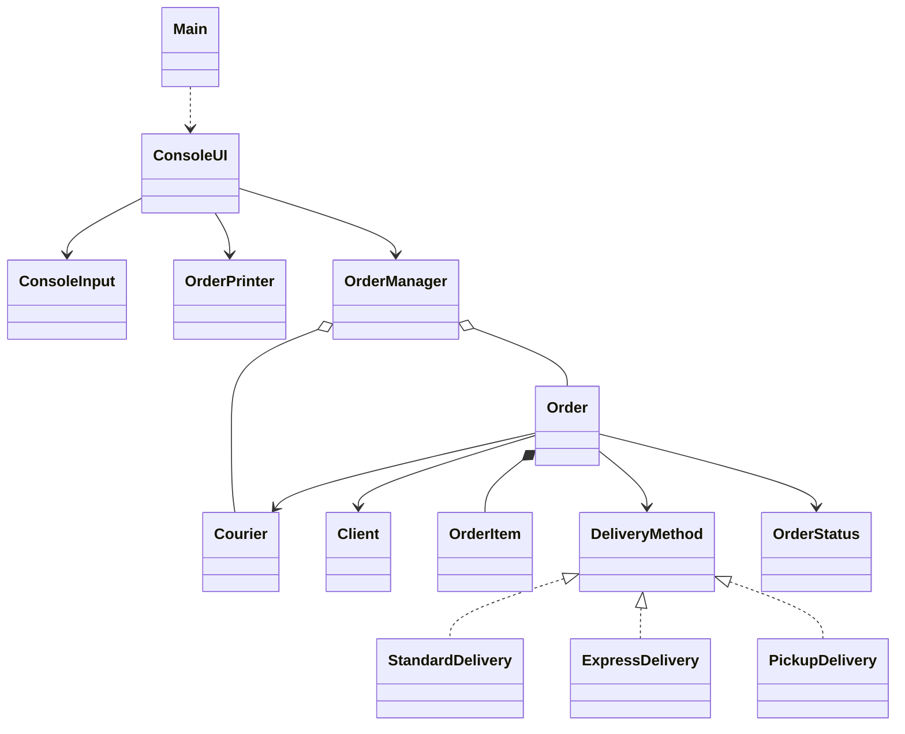

# Архитектура и соответствие заданию

Композиция понимается как построение заказа из объектов. В строгом UML клиент и стратегия передаются извне и являются ассоциациями; позиции — логическая составная часть заказа. Java не обеспечивает эксклюзивное владение ссылкой: неизменяемый OrderItem технически можно передать нескольким заказам. OrderManager хранит заказы, но они могут иметь внешние ссылки; поэтому отношение показано как агрегация.

| Требование | Реализация |
|---|---|
| Заказ с несколькими позициями | ConsoleUI.createOrder, OrderManager.createOrder |
| Клиент, курьер, позиция | Client, Courier, OrderItem |
| Три способа доставки | DeliveryMethod и три реализации |
| Стоимость и срок | calculateCost, getEstimatedTime, OrderPrinter |
| Курьер | Order.assignCourier, Courier.reserve |
| Допустимые статусы | OrderStatus.canTransitionTo, Order.changeStatus |
| Инкапсуляция | private, final, проверяющие методы, List.copyOf |
| Сервис отдельно от консоли | OrderManager, ConsoleUI |
| Ввод и вывод | ConsoleInput, OrderPrinter |
| Ошибки ввода | Построчный разбор, повтор ввода, обработка EOF |
| Выход | Пункт 6 |
| Git | Коммиты по этапам разработки |

Поиск заказа в LinkedHashMap — в среднем O(1), подсчёт суммы — O(n) по числу позиций. Приложение однопоточное; многопоточная безопасность и сохранение данных не входят в модель. Назначение резервирует нового курьера до освобождения старого.

36 проверок охватывают тарифы, деньги, номера, защищённые списки, валидацию, статусы, самовывоз, занятость и замену курьера, ошибочные числа и EOF.
